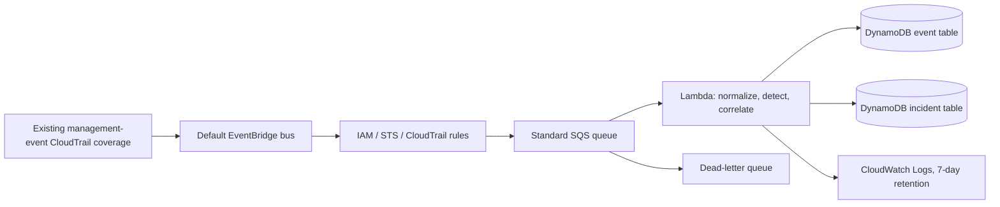

# AWS architecture and operating boundaries

Phase 3 adds a separate, opt-in AWS runtime. The local CLI and SQLite remain the default. The CloudFormation stack is prepared and locally tested; it has **not** been deployed or verified in an AWS account.

The three rules select `AttachRolePolicy`, `AssumeRole`, `StopLogging`, and `DeleteTrail`. `AssumeRole` requires the EventBridge rule state `ENABLED_WITH_ALL_CLOUDTRAIL_MANAGEMENT_EVENTS` because it is a read-only management event. The rule targets the default bus and sends the complete EventBridge envelope to SQS. Lambda accepts at most 10 messages per invocation, validates JSON and envelope structure, reuses the local normalizer and rules, and persists selected normalized fields. It never writes `responseElements` or raw messages to DynamoDB or logs.

CloudTrail management-event coverage must already be active in the chosen account and region; this stack creates no trail. EventBridge delivery of CloudTrail-originated service events is best effort. IAM and some STS activity from global endpoints has region-specific logging behavior; deploy and verify in the region where the relevant events are emitted (often `us-east-1`). Regional STS endpoints, CloudTrail trail scope, and trail event selectors affect coverage. A cross-account or cross-region collection design is outside this stack. See [AWS EventBridge service events](https://docs.aws.amazon.com/eventbridge/latest/userguide/eb-service-event-cloudtrail.html), [read-only management events](https://docs.aws.amazon.com/eventbridge/latest/userguide/eb-service-event-cloudtrail-management.html), and [CloudTrail management-event selectors](https://docs.aws.amazon.com/awscloudtrail/latest/userguide/logging-management-events-with-cloudtrail.html).

## Persistence and consistency

The event table uses string `pk`/`sk`. `EVENT#<account>:<eventID>`/`META` stores one normalized event; `EVAL#<rule>#<version>` under the same partition records versioned evaluations. `DETECTION#<stable ID>`/`META` stores a detection. A SHA-256 `SCOPE#<hash>` partition holds `DET#<event-time-microseconds>#<detection ID>` index rows and a `LOCK` revision. The hash input contains correlation family, account, caller type/principal/ARN/account/session issuer, and exact resource identity. Missing correlation evidence gets a unique solo scope. The key contains no raw ARN or principal value; indexed values still contain selected sensitive identifiers and require IAM protection.

The incident table uses `INCIDENT#<stable ID>`/`META` for current state and `HIST#...` rows for append-only change history. `AccountTime` (`gsi1pk=ACCOUNT#<account>`, `gsi1sk=TIME#<first-seen>#<ID>`) supports bounded account/time listing. Direct incident and history reads are strongly consistent. A GSI read is eventually consistent; the adapter re-reads `META` and filters `is_current` before reporting current incidents. A new incident can be temporarily absent from a GSI list. The Lambda role has query access to this specific index, although ingestion itself uses direct keys and scope queries.

Ingestion first conditionally stores an event, then evaluations and detections. A retry continues even if the event row already exists, recovering from an interruption between these steps. Detection identity and incident identity use the existing Phase 2 functions. The adapter queries a bounded event-time neighborhood within the exact scope and expands through linked incident members. It computes groups with the existing pure correlator. A conditional DynamoDB transaction changes scope membership, incident projections, and history together. The scope lock and per-item revisions force concurrent writers to reread and retry; incident assessment updates also use revision conditions. A duplicate delivery leaves the resulting state unchanged. Lambda reports only failed SQS message IDs so successful messages are acknowledged independently. SQS and Lambda remain at-least-once, with no ordering guarantee; the 180-second queue visibility timeout is six times the 30-second function timeout. See [Lambda SQS failure handling](https://docs.aws.amazon.com/lambda/latest/dg/services-sqs-errorhandling.html) and [DynamoDB transactions](https://docs.aws.amazon.com/amazondynamodb/latest/APIReference/API_TransactWriteItems.html).

## Deliberate cloud limits

- A connected scope closure is capped at 16 detections and a normalized context at 16 KiB. A larger scope or transaction fails the SQS record; after five receives it reaches the DLQ. Nothing is silently discarded from an already stored detection. Investigate and handle that scope before redriving. Capacity and hot-key load need live measurement.
- Cloud reprocessing is explicit for one stored event. A newer rule version can update an existing match in the same scope; removing a match, moving its scope, and changing the correlation window on an existing stack require a controlled rebuild. This is narrower than SQLite's full-database reprocess. Keep the rule version unchanged only when logic is unchanged.
- The cloud runtime exposes store methods for bounded account listing, direct incident/history reads, and assessment updates, but this stack does not expose an analyst API or run the local SQLite CLI against DynamoDB. There is no dashboard or response automation.
- Account listing reads at most 100 index candidates and history reads at most 100 rows, without pagination. A long-lived account or incident needs a paginated read path before analyst-facing use.
- The bounded query and retry workflow does not claim exact global Phase 2 reconciliation under arbitrary high-volume, concurrent, or cross-region streams. Successful offline tests are not evidence of live AWS coverage, latency, or cost.

## Security, recovery, and cost

The Lambda role reads only its SQS queue, writes and queries only the stack's two DynamoDB tables, and writes only its log group. EventBridge may send to the queue only from the three stack rules and this account. SQS and DynamoDB use AWS-managed encryption at rest. The AWS SDK uses HTTPS/TLS. There are no public endpoints, stored credentials, VPC, NAT gateway, or long-lived compute. Logs contain only per-batch counts and no raw payload or exception text. DynamoDB data and redriven DLQ bodies can still contain sensitive identifiers; restrict operator access. CloudTrail and EventBridge content should be treated as untrusted input despite AWS delivery.

Monitor Lambda errors/throttles, SQS age and DLQ depth, EventBridge failed invocations, and DynamoDB throttles. A malformed JSON or unsupported envelope is acknowledged and counted; a transient write or bounded-capacity failure is retried and ultimately dead-lettered. Inspect failures with restricted access, address the cause, and use SQS redrive or re-send a sanitized event only after verifying identity and rule behavior. Never publish DLQ payloads in logs or issue trackers. CloudFormation stack deletion removes both DynamoDB tables, queues, Lambda, rules, and log group, including their data. External CloudTrail trails and the operator-owned S3 artifact/bucket remain.

On-demand DynamoDB, SQS, Lambda, EventBridge, and CloudWatch Logs are usage-based and may incur charges. Existing CloudTrail management-event delivery may have charges; adding a duplicate trail or management-event copies can add cost. The artifact bucket and object also incur S3 charges until removed. See [deployment and teardown](DEPLOYMENT.md).
